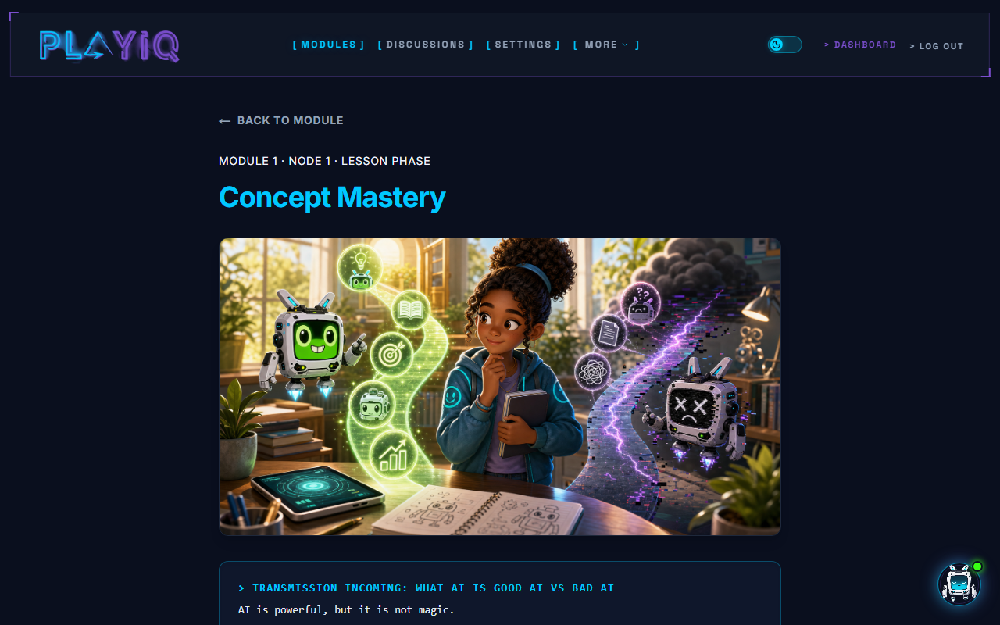

# PlayIQ Original Visual Baseline

## Confirmed reference

On November 5, 2026, Scott reviewed the existing saved lesson screenshot and answered: **“Yes—restore this look and its full colour treatment.”** This is the visual reference for the course-material update, not approval of an earlier course's content, old progress mapping, or a whole-repository rollback.

Source: locally synced `My Drive/PlayIQ/QA screenshots/m1_n1_1_lesson.png`.
SHA256: `04891e0c6b54f8ffa9345438986893a0562b78f811511fd283b1a8570d9cccb7`.
Additional unfilled original activity and mini-check screens are included in `evidence/`. They support interaction and colour fidelity; do not restore their obsolete lesson text or reproduce incidental defects such as headings obscured by a fixed navbar.

## Exact source revision

Recovered pre-course-release reference: **`7ee00fc254b7dc48f0d51de657eaa089d1be0a42`**, the explicit base of the October 30 weekend release. It preserves the original dark course route structure before the long-form release shell was added. The screenshot is Scott's approved appearance; the commit is the recovered implementation reference, not proof that every behaviour at that commit was accepted.

At preparation, `src/app/globals.css`, `src/app/layout.tsx`, and `src/components/layout/PlayIQLogo.tsx` were byte-identical between that reference and integration base `9cbde86ab28d9922a29354419767bd183db1d45a`. Much of the original design remains present but is bypassed by the newer course routes. Use current components where they retain the reference; restore selectively rather than resetting the application.

The last relevant visual lineage is:

| Revision | Purpose |
|---|---|
| `0de38008a846dd033791e81eb8425ab0aa289b56` | Introduces the cropped PNG logo rather than the earlier SVG implementation. |
| `417889339fd19bc779f43a3c5c95bc093fd117ce` | Deck palette and typography: deep navy, cyan, purple, gold, Space Grotesk display and Inter body. |
| `7ee00fc254b7dc48f0d51de657eaa089d1be0a42` | Complete pre-release course/assessment/dashboard reference. |
| `5a3ea59a693e9ce15781431b93dc1dbece5ea1e3` | Adds the complete fifteen-module curriculum and evidence flow, but also introduces the rejected long-form light course presentation. Retain the new content and data functions, not that presentation. |
| `2e0fb104e9a04e3d1a8f2ea58281a4ca58e40618` | Course flags redirect student home before rendering the original dashboard/tour and exempt release shells from the legacy assessment gate. Reconcile routing deliberately. Do not simply disable a flag and serve old lessons. |

Do not silently switch to the substantially older April palette/Orbitron revision `482d19bc95ef301962fed28fcce27f134e56107b`. Scott has now confirmed the recovered screenshot. Keep its full colour treatment, including purple/pink accents, cyan/teal, gradients and colourful illustrations, rather than reducing it to a cyan border on dark cards.

## Components and assets to reuse

- Logo: `src/components/layout/PlayIQLogo.tsx` and `public/images/playiq-logo-cropped.png`. PNG SHA256 `9cf9ed073445a652029a0bf6a86ff2b429284fae6f282594ebefcb9a9c0070a9`. Do not draw a text replacement or regenerate the brand mark.
- Theme and fonts: `src/app/globals.css`, `src/app/layout.tsx`, existing display/body/monospace styles, gradients, border accents and button classes. Reference tokens include navy `#0a0f1e`, cyan `#00c8ff`, purple `#7b4fce`, light purple `#9b6fe8`, gold `#f5c518`, green `#39ff14`; retain the actual component treatment and artwork rather than treating this token list as a new design specification.
- Overview and phase pages: `src/app/(dashboard)/student/modules/*/overview/page.tsx` and `nodes/[nodeId]/{lesson,activity,mini-check,teach-back,completion}` where present.
- Lesson presentation and media: `src/components/modules/LessonContentRenderer.tsx`, `ModuleOpeningHook.tsx`, `ModuleIntroVideo.tsx`, `ModulePdfDownload.tsx`, and `public/images/modules/`.
- Assessment: `OrionAssessment.tsx`, `OrionTypingEffect.tsx`, `ScenarioCard.tsx`, `BaselineChallenge.tsx`, `LearningBlueprint.tsx`, and `AIWorkspaceTutorial.tsx` under `src/components/assessment/`.
- Orientation: `src/components/dashboard/CourseNavigationGuide.tsx`, `DashboardTour.tsx`, and original student dashboard presentation. `WelcomeOrientation.tsx` is an older inline card, not evidence that a modal should be newly invented.

Use the new curriculum in those surfaces. Do not copy the legacy module lists, UUID assumptions, hard-coded node counts, scoring results, or old Assistant/Capstone numbering.

## Original Orion introduction and current companion

The recovered assessment journey is Orion opening transmission, learner details, five diagnostic scenarios, three baseline challenges, rescue/advance targets and goal, results and Learning Blueprint, then the external AI workspace tutorial and handshake. Parent setup now precedes the student opening, as already approved.

The original dashboard tour is replayable and includes Welcome, Active Challenge, Pilot Handle, Parent Visibility, Engagement Board, Orion, and Beta Feedback. Its old instructional labels need the fifteen-module content update; its interaction style should not be replaced by a textbook.

Two historical details must not be conflated:

- `8d236ab6567655155131db26ae55617f477da201` wired the sleep clip into the closed circular chat launcher and the awake clip into a manual-open boot overlay, with end/Skip Intro revealing chat.
- `62ab36a5ed0f90cb06db6508a3894c9c0a526868` deliberately removed that per-open video delay. The assets remain, but their presence does not authorize playing a boot video every time chat opens.

`cb1490f1fe8e690381eacfa70513dae067e4f750` stops the tour from automatically opening chat. Preserve the established first-visit welcome/assessment experience, the current working floating companion, and a single chat. Do not restore the obsolete boxed live launcher or undo later Orion/security/data fixes just to recover an introduction.

No new visual or interaction design is requested. Any uncertain introduction placement is resolved within Scott's actual Modules 00 through 2 review, not by imposing an additional founder approval stage.
